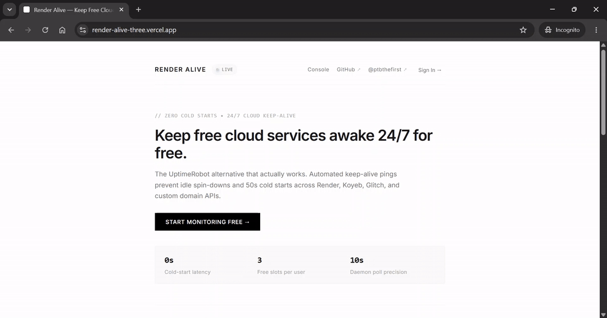

# Render Alive ⚡

> Keep free cloud services awake 24/7 for free. The UptimeRobot alternative that actually works.

An automated keep-alive daemon specifically tuned for **Render, Koyeb, Glitch, and custom domain APIs**. It eliminates 15-minute idle spin-downs and 50+ second cold starts with precision 14-minute pings, without exhausting your monthly free-tier hours.

---

## 📽️ Demo

  

---

## 🚀 Getting Started

👉 **Use the hosted service (Recommended):**  
### 🌐 **[https://render-alive-three.vercel.app](https://render-alive-three.vercel.app)**

1. Enter your `.onrender.com`, `koyeb.app`, `glitch.me`, or custom API URL.
2. Select your ping interval (default: 14 minutes).
3. Your service stays warm 24/7 with zero cold starts.

> **Note on self-hosting:** Render Alive’s keep-alive engine relies on an offloaded background daemon running 24/7 on a dedicated Oracle Cloud VPS synced with Upstash Redis. We strongly recommend using the free hosted web application above rather than configuring and managing the VPS infrastructure manually.

---

## 📄 License

Distributed under the [MIT License](LICENSE).
